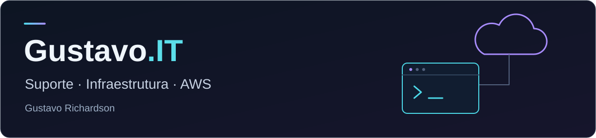

# Gustavo Richardson

**Suporte de TI · Redes e infraestrutura · AWS**

[LinkedIn](https://www.linkedin.com/in/gustavo-richardson/) · [WhatsApp](https://wa.me/5581983052508) · [E-mail](mailto:gustavo.richardson@outlook.com) · [Portfólio](https://gustavorichardson.github.io/)

## Sobre mim

Sou de Cabo de Santo Agostinho, Pernambuco, e curso Análise e Desenvolvimento de Sistemas. Trabalhei por dois anos na Amazon, em operações e Problem Solve, investigando problemas, melhorando processos e treinando colegas.

Meu objetivo é atuar em Suporte Técnico Júnior, Help Desk ou Service Desk N1, com evolução para infraestrutura e suporte cloud. Aqui compartilho meus estudos e projetos em TI.

## Como resolvo problemas

Na Amazon REC1/3, como Assistente de Operações / Problem Solve (2024–2026):

| Problema | O que fiz | Resultado |
| --- | --- | --- |
| Incidentes recorrentes em equipamentos críticos | Apliquei troubleshooting estruturado e registrei as ocorrências nos sistemas internos. | De **3 incidentes por mês para 1 a cada 2 meses**. |
| Tempo gasto no registro manual de dados | Automatizei o preenchimento com Excel, eliminando retrabalho. | De **90 para 12 minutos**, redução de aproximadamente **87%**. |
| Erros de registro na operação | Treinei **2 colaboradores** em troubleshooting e boas práticas. | Erros de registro zerados e produtividade acima da meta. |

## Estudos e ferramentas

| Área | Meu contato com ela |
| --- | --- |
| **Suporte** | Troubleshooting, documentação e estudos de atendimento com Zendesk e Jira Service Management. |
| **Sistemas e redes** | Linux, TCP/IP, DNS, DHCP e VPN. Active Directory e Windows Server em estudo. |
| **AWS** | Estudos de EC2, S3, IAM e VPC, com fundamentos de segurança e infraestrutura. |
| **Ferramentas** | Excel na melhoria de processos; Git, GitHub e VS Code nos estudos e projetos. |
| **Automação e IA** | Noções de Python e SQL, fundamentos de Docker e uso de IA generativa como apoio aos projetos. |

## Formação e trilha de aprendizado

- **ADS — Estácio:** em andamento, com conclusão prevista para junho de 2028.
- **AWS re/Start — Escola da Nuvem (300h):** aguardando emissão do certificado.
- **Zendesk:** Foundational Support e Omnichannel Agent.
- **Google:** Technical Support Fundamentals e The Bits and Bytes of Computer Networking; formação Google IT Support em andamento.

Minha trilha: **suporte e redes → sistemas e infraestrutura → AWS → automação**. Quero aplicar essa base em projetos e aprofundar provisionamento e implantação com CloudFormation e Elastic Beanstalk.

## Certificações que pretendo buscar

| Nuvem | Objetivos |
| --- | --- |
| **AWS** | Cloud Practitioner, AI Practitioner e Solutions Architect – Associate. |
| **Google Cloud** | Fundamentos de cloud; certificação a definir. |
| **Microsoft Azure** | Azure Fundamentals. |

Essas certificações são metas de estudo, ainda não obtidas.

## Projetos

Desenvolvo estes projetos com apoio de IA generativa. Uso esse processo para estudar as soluções e entender seu funcionamento.

| Projeto | Proposta | Situação |
| --- | --- | --- |
| **AWS Simulados** | Plataforma para estudar para o Cloud Practitioner, com simulados, correção no servidor e geração de questões com IA. | Em ambiente local; deploy AWS planejado. |
| **AI Job Assistant** | Automação da busca e triagem de vagas com IA local e Ollama. | Em desenvolvimento. |

[Ver meu portfólio](https://gustavorichardson.github.io/) · [Explorar meus repositórios](https://github.com/gustavorichardson?tab=repositories)
